# Routiq — Technical Architecture Specification

**Product:** Routiq (Heavy Vehicle-Aware Smart Routing)  
**Document Version:** 2.0.0 (Production Backend & Integrations Implemented)  
**Target Environments:** Vercel (Full-Stack Deployment), Node.js / Docker (Standalone)

---

## 1. System Overview & Clean Separation

Routiq follows a modular Hexagonal / Ports-and-Adapters architecture. The frontend UI communicates exclusively through typed Service Interfaces (`src/services/*`), which connect directly to the production Express serverless and REST API (`/api/*`).

```mermaid
graph TD
    subgraph Frontend [Routiq Client - React 19 + TypeScript + Vite + MapLibre GL]
        UI[UI Components & Layout]
        MapComp[MapLibre GL Map View]
        State[React State & Contexts]
        
        UI --> MapComp
        UI --> State
        
        subgraph ClientAdapters [Client Service Adapters]
            IRouting[ProductionRoutingService]
            IVehicle[VehicleService]
            IVahan[ProductionVahanLookupService]
            IAuth[ProductionAuthService]
        end
        
        State --> IRouting
        State --> IVehicle
        State --> IVahan
        State --> IAuth
    end

    subgraph BackendAPI [Production Backend - Node.js + Express API]
        Router[API Gateway & Router]
        AuthCtrl[Auth & Session Controller]
        RouteCtrl[Routing & Alternatives Controller]
        GisCtrl[Spatial Engine & Restriction Controller]
        GeoCtrl[Geocoding Controller]
        PoiCtrl[Commercial Places / POI Controller]
        VahanCtrl[VAHAN / ULIP Gateway Adapter]
        DbCtrl[Database Repository Layer]

        Router --> AuthCtrl
        Router --> RouteCtrl
        Router --> GisCtrl
        Router --> GeoCtrl
        Router --> PoiCtrl
        Router --> VahanCtrl
        Router --> DbCtrl
    end

    subgraph ExternalServices [External Engines & Spatial Datasets]
        Valhalla[Valhalla Truck Costing Engine]
        ORS[OpenRouteService HGV]
        OSRM[OSRM Road Network]
        Overpass[OpenStreetMap Overpass POI API]
        Photon[Photon / Nominatim OSM Geocoder]
        VahanGov[Government VAHAN / ULIP Gateway]
        DB[(PostgreSQL + PostGIS / In-Memory Store)]
    end

    IRouting ==>|POST /api/routes| RouteCtrl
    IVehicle ==>|GET / POST /api/vehicles| DbCtrl
    IVahan ==>|POST /api/vehicles/lookup| VahanCtrl
    IAuth ==>|POST /api/auth/*| AuthCtrl

    RouteCtrl --> Valhalla
    RouteCtrl --> ORS
    RouteCtrl --> OSRM
    RouteCtrl --> GisCtrl
    GeoCtrl --> Photon
    PoiCtrl --> Overpass
    VahanCtrl --> VahanGov
    DbCtrl --> DB
```



---

## 2. Component & Directory Architecture

```
/
├── audit_report.md            # Phase 1 & 2 Architectural Audit Report
├── prd.md                     # Product Requirements Document
├── architecture.md            # Technical Architecture Specification
├── rules.md                   # Enforceable Engineering Rules & Governance
├── design.md                  # Design System & UI Specification
├── tasks.md                   # Implementation Checklist & Tasks
├── memory.md                  # Decisions & Technical Ledger
├── README.md                  # Quick Start & Deployment Guide
├── .env.example               # Complete Environment Variables Template
├── vercel.json                # Vercel Full-Stack Deployment Config
├── package.json               # Dependencies & Verification Scripts
├── api/
│   └── index.ts               # Vercel Serverless Function Entrypoint
├── tests/
│   ├── health.test.ts         # Server Health & Readiness Tests
│   ├── auth.test.ts           # Authentication & JWT Tests
│   ├── geocoding.test.ts      # Address Search & Reverse Geocode Tests
│   ├── routing.test.ts        # Truck Routing & Clearance Tests
│   ├── gis.test.ts            # Spatial Buffer Collision Tests
│   ├── vahan.test.ts          # VAHAN Gateway Validation Tests
│   ├── places.test.ts         # Commercial POI Discovery Tests
│   └── vehicles.test.ts       # Fleet Profile CRUD Persistence Tests
└── src/
    ├── types/                 # Shared Domain Models (Vehicles, Routes, VAHAN, Auth)
    ├── i18n/                  # Bilingual Translations (English & Hindi)
    ├── services/              # Client-Side Service Interfaces & Adapters
    ├── components/            # UI Components (Layout, Map, Routing, Vehicles, Auth)
    └── server/                # Production Backend Implementation
        ├── config/            # Zod Environment Validation
        ├── database/          # PostgreSQL + PostGIS Schema & Repository
        ├── auth/              # JWT Issuance & Bcrypt Password Hashing
        ├── middleware/        # Authentication & Request Tracing Middleware
        ├── geocoding/         # Photon & Nominatim Geocoding Engine
        ├── gis/               # Turf.js Spatial Analysis & Restriction Hotspots
        ├── places/            # Commercial Freight POI Discovery (Overpass)
        ├── routing/           # Valhalla, ORS, OSRM, & Corridor Providers
        ├── vahan/             # VAHAN / ULIP Vehicle Lookup Adapter
        ├── routes/            # Express Endpoint Routers
        ├── app.ts             # Express App Configuration
        └── index.ts           # Standalone Server Entrypoint
```

---

## 3. Multi-Provider Truck Routing Architecture

1. **Valhalla Engine (`ValhallaProvider`):** Primary routing engine for environments with self-hosted or cloud Valhalla. Uses the `truck` costing model passing `height`, `width`, `weight`, `axle_load`, `length`, `axle_count`, and `hazmat`.
2. **OpenRouteService (`OpenRouteServiceProvider`):** Uses the `driving-hgv` profile specifying `max_height`, `max_width`, and `max_weight` parameters.
3. **OSRM + Spatial Engine (`OsrmRoutingProvider`):** Retrieves genuine road geometry and turn instructions for any Indian coordinates, which are evaluated by the Spatial Engine.
4. **Offline Corridor Fallback (`OfflineCorridorProvider`):** Provides verified high-precision alignments for major Indian freight gateways (Mumbai–Pune, Mumbai–Nashik, Pune–Nashik, Delhi–Jaipur).
5. **Spatial Engine (`SpatialEngine`):** Uses `@turf/turf` to measure perpendicular proximity from route LineString to known restriction hazards. Points within buffer radius are evaluated against physical vehicle dimensions.
6. **Road-Width Intelligence:** Implements Rule 1.1: missing or unsurveyed carriageway widths are flagged as `"Data Unavailable / Unverified"`, preventing false safety claims.

---

## 4. VAHAN / ULIP Vehicle Data Security

1. Server-side proxy (`POST /api/vehicles/lookup`) keeps all credentials off client browsers.
2. Formats are strictly validated against Indian registration regex (`^[A-Z]{2}[0-9]{1,2}[A-Z]{0,3}[0-9]{4}$`).
3. If credentials are not configured, server returns structured `UNCONFIGURED_CREDENTIALS` status with instructions and manual entry fallback. No fake records are returned.
4. Driver confirmation is always enforced (`requiresDriverConfirmation: true`) because registration documents do not guarantee current payload container height or loaded weight.

---

## 5. Database & Security Model

1. **Database:** PostgreSQL with PostGIS extension for spatial queries. When `DATABASE_URL` is omitted, operates with an in-memory transactional store for zero-friction local development and testing.
2. **Passwords:** Hashed with `bcryptjs` (10 rounds).
3. **Authentication:** 7-day signed JWT tokens issued in `POST /api/auth/login` and verified by `requireAuth` middleware.
4. **Data Isolation:** Vehicle profiles and saved routes are isolated by `user_id`.
