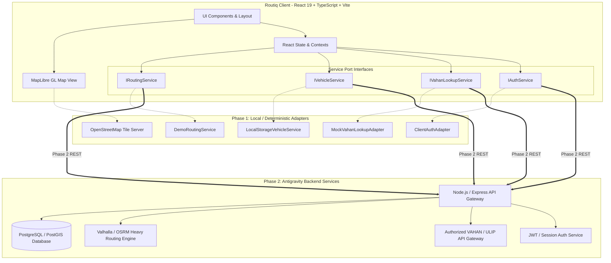
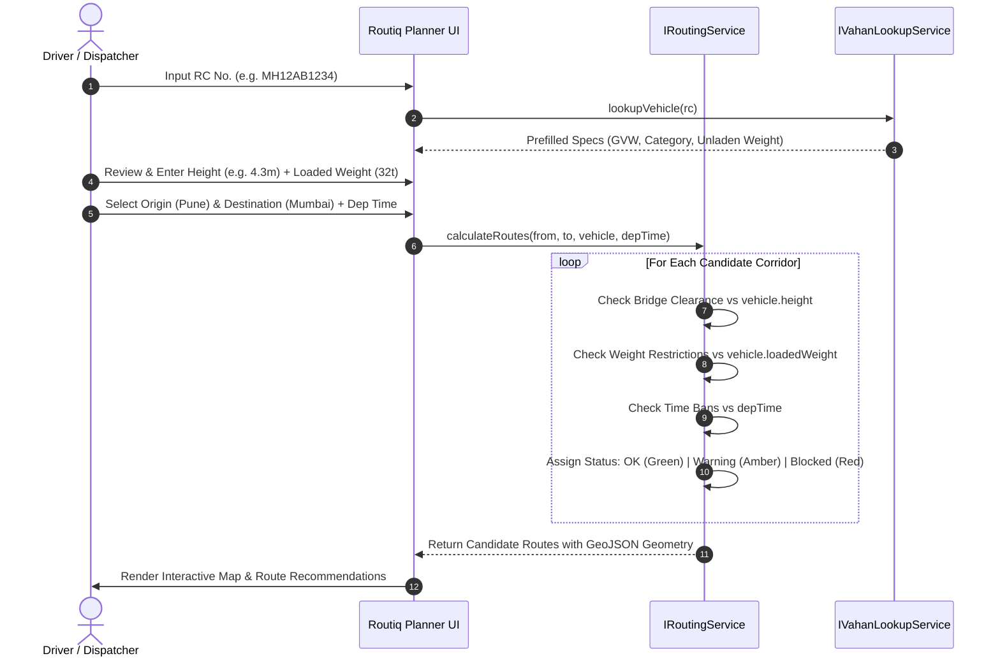

# Routiq — Technical Architecture Specification

**Product:** Routiq (Heavy Vehicle-Aware Smart Routing)  
**Document Version:** 1.0.0  
**Target Environments:** Vercel (Frontend), Antigravity Backend (Express / Node.js / PostgreSQL / GIS)

---

## 1. System Overview & Clean Separation

Routiq follows a modular Hexagonal / Ports-and-Adapters architecture. The frontend UI communicates exclusively through typed Service Interfaces (`src/services/*`), allowing seamless transition from Phase 1 client adapters to Phase 2 Antigravity HTTP/REST and WebSocket APIs without modifying React presentation components.



---

## 2. Component & Directory Architecture

```
/
├── prd.md
├── architecture.md
├── rules.md
├── design.md
├── tasks.md
├── memory.md
├── README.md
├── vercel.json
├── index.html
├── package.json
└── src/
    ├── types/
    │   ├── index.ts              # Domain entities (Vehicle, Route, Restriction, GIS)
    │   ├── vahan.ts              # VAHAN API request, response, and normalized models
    │   └── auth.ts               # User, Session, Credentials, AuthState
    ├── i18n/
    │   ├── translations.ts       # Structured en & hi dictionaries
    │   └── context.tsx           # LanguageContext provider and useTranslation hook
    ├── services/
    │   ├── gis/
    │   │   └── geoUtils.ts       # GeoJSON builders, bounds calculation, distance math
    │   ├── maps/
    │   │   └── maplibreConfig.ts # OSM tile sources, style definition, fallback layers
    │   ├── routing/
    │   │   ├── types.ts          # IRoutingService interface
    │   │   ├── demoData.ts       # Verified Indian freight corridor GeoJSON coordinates
    │   │   └── routingService.ts # Constraint evaluator and route calculator
    │   ├── vehicles/
    │   │   ├── types.ts          # IVehicleService interface
    │   │   └── vehicleService.ts # Local profile store with validation
    │   ├── vahan/
    │   │   ├── types.ts          # IVahanLookupService interface
    │   │   └── vahanService.ts   # Registration validator & lookup adapter
    │   └── auth/
    │       ├── types.ts          # IAuthService interface
    │       └── authService.ts    # Frontend authentication client
    ├── components/
    │   ├── layout/
    │   │   ├── Header.tsx        # Top app bar, brand, bilingual selector, auth/upgrade
    │   │   └── Navigation.tsx    # Mobile & desktop tab switching
    │   ├── map/
    │   │   ├── InteractiveMap.tsx# Genuine MapLibre GL JS map with markers & polylines
    │   │   ├── MapLegend.tsx     # Route status and marker symbol guide
    │   │   └── MapFallback.tsx   # Offline/WebGL fallback schematic renderer
    │   ├── routing/
    │   │   ├── RoutePlanner.tsx  # Origin/Destination search, vehicle selection, departure
    │   │   ├── RouteResults.tsx  # Viable/Warning/Blocked route cards & turns
    │   │   └── RestrictionDetailModal.tsx # Inspection drawer for bridge/load/timing limits
    │   ├── vehicles/
    │   │   ├── VehicleManager.tsx# Active vehicle list, specs, edit/delete
    │   │   ├── VehicleFormModal.tsx# Manual edit modal
    │   │   └── VahanLookupSection.tsx # Indian RC number search & prefill
    │   ├── auth/
    │   │   └── AuthModal.tsx     # Sign in / Sign up dialog with password visibility
    │   ├── subscription/
    │   │   └── SubscriptionModal.tsx # Free / Pro / Fleet tier comparison
    │   └── settings/
    │       └── SettingsHelp.tsx  # FAQs, terms, disclaimer, safety notices
    ├── App.tsx                   # Main state orchestration and root layout
    ├── main.tsx                  # React 19 entry point
    └── index.css                 # Tailwind CSS v4 styling & typography
```

---

## 3. MapLibre, OpenStreetMap, and GIS Integration

### 3.1 Mapping Stack
- **Renderer:** MapLibre GL JS (v4.7+).
- **Tile Provider:** OpenStreetMap standard raster tiles (`https://tile.openstreetmap.org/{z}/{x}/{y}.png`) with standard attribution:
  `&copy; <a href="https://www.openstreetmap.org/copyright" target="_blank">OpenStreetMap</a> contributors`.
- **Projection & Coordinates:** Standard EPSG:4326 (`[longitude, latitude]`) coordinates in GeoJSON format.

### 3.2 GIS Layers & Data Model
- **Route LineString Features:** Candidate paths modeled as GeoJSON LineStrings with elevation profiles, road category (Expressway, National Highway, State Highway, Ghat Section).
- **Point Features (Restrictions):**
  - Point locations for low clearances (`kind: "bridge"`), axle limit bridges (`kind: "axle"`), gross load limits (`kind: "weight"`), and timed municipal restrictions (`kind: "time_ban"`).
  - Attached properties: `clearanceMeters`, `maxWeightTonnes`, `timeWindow`, `roadName`, `authoritySource`, `verificationStatus`.
- **Bounding Box Auto-fitting:**
  - Automated `map.fitBounds([[minLng, minLat], [maxLng, maxLat]], { padding: 50 })` on route calculation.

### 3.3 Note on MapArc
- As dictated in the project directive, "MapArc" is not an industry-standard open-source library or confirmed provider. No unverified proprietary package is stubbed. An abstract GIS adapter interface (`IGisProvider`) is provided should MapArc be clarified as a specific spatial server or SDK in Phase 2.

---

## 4. Constraint Evaluation Engine (Truck Routing Logic)



### 4.1 Evaluation Criteria
1. **Height Clearance Rule:** If `restriction.clearanceMeters <= vehicle.heightMeters`, status = `BLOCKED` (CRITICAL RED).
2. **Weight Limit Rule:** If `restriction.maxWeightTonnes < vehicle.loadedWeightTonnes`, status = `BLOCKED` (CRITICAL RED).
3. **Time Ban Rule:** If `departureTime` intersects `restriction.timeWindow`, status = `WARNING` (AMBER ADVISORY) with turn-around / rest area guidance.
4. **Missing Data Rule:** If restriction data is incomplete, flag as `WARNING_UNVERIFIED` (AMBER). *Never treat absent data as clearance.*

---

## 5. VAHAN Vehicle-Data API Architecture (Phase 1 & Phase 2)

### 5.1 Frontend Interface (`IVahanLookupService`)
```typescript
export interface IVahanLookupService {
  lookupVehicle(registrationNumber: string): Promise<VahanLookupResult>;
  validateRegistrationFormat(registrationNumber: string): boolean;
}
```

### 5.2 Registration Validation Regex
Matches Indian standard formats (MoRTH Gazette):
- State Code (2 letters) + RTO Code (2 digits) + Optional Series (1-3 letters) + Unique Number (4 digits).
- Example: `^[A-Z]{2}[0-9]{1,2}[A-Z]{0,3}[0-9]{4}$` (ignoring whitespace and hyphens).

### 5.3 Antigravity Backend Implementation (`POST /api/vehicles/lookup`)
In Phase 2, Antigravity will route lookups through authorized gateways (ULIP / National Transport Portal or licensed commercial aggregators):
- Server-side API key and IP whitelisting.
- Rate limiting: max 10 requests / minute per authenticated IP / driver account.
- PII sanitization: Remove owner personal names, mobile numbers, and bank hypothecation details; forward only technical freight attributes (GVW, category, dimensions, fuel, axle count).

---

## 6. Antigravity Backend Architecture Specifications

When Antigravity implements Phase 2, the following stack and endpoints are specified:

### 6.1 Database Schema (PostgreSQL + PostGIS)
- **`users`**: `id UUID PRIMARY KEY`, `email VARCHAR`, `phone VARCHAR`, `name VARCHAR`, `tier VARCHAR DEFAULT 'free'`, `created_at TIMESTAMP`.
- **`vehicles`**: `id UUID PRIMARY KEY`, `user_id UUID REFERENCES users(id)`, `registration_number VARCHAR`, `nickname VARCHAR`, `category VARCHAR`, `gvw NUMERIC`, `loaded_weight NUMERIC`, `height NUMERIC`, `width NUMERIC`, `length NUMERIC`, `axles INTEGER`, `cargo_type VARCHAR`.
- **`restrictions`**: `id UUID PRIMARY KEY`, `kind VARCHAR`, `geom GEOMETRY(Point, 4326)`, `road_name VARCHAR`, `clearance_height NUMERIC`, `max_weight NUMERIC`, `time_start TIME`, `time_end TIME`, `is_verified BOOLEAN`, `updated_at TIMESTAMP`.
- **`routes_cache`**: `id UUID PRIMARY KEY`, `origin_geom GEOMETRY`, `dest_geom GEOMETRY`, `geojson_feature JSONB`, `calculated_at TIMESTAMP`.

### 6.2 Proposed Antigravity REST API Routes
- `POST /api/auth/register` — Create user account with hashed password.
- `POST /api/auth/login` — Issue HTTP-only JWT session cookie.
- `GET /api/auth/me` — Return authenticated user profile.
- `GET /api/vehicles` — List user's saved vehicles.
- `POST /api/vehicles` — Create vehicle profile.
- `PUT /api/vehicles/:id` — Update vehicle profile.
- `DELETE /api/vehicles/:id` — Remove vehicle profile.
- `POST /api/vehicles/lookup` — Proxy VAHAN vehicle lookup with server secrets.
- `POST /api/routes/calculate` — Execute truck-aware routing against PostGIS road graph.
- `GET /api/restrictions/corridor` — Query spatial bounding box for active restrictions.

---

## 7. Security & Environment Variables

### 7.1 Client-Side (Vite / Vercel Frontend)
- No private API keys or database connection strings in `src/`.
- `VITE_MAP_STYLE_URL`: (Optional) URL for custom MapLibre vector style (defaults to OpenStreetMap raster tiles).
- `VITE_API_BASE_URL`: (Optional) Base URL for Antigravity backend in Phase 2 (defaults to empty string for local/demo mode).

### 7.2 Server-Side (Phase 2 Antigravity Backend)
- `DATABASE_URL`: PostgreSQL connection string with PostGIS extension.
- `JWT_SECRET`: 256-bit secret for signing user session tokens.
- `VAHAN_API_KEY` & `VAHAN_API_SECRET`: Credentials for authorized ULIP/VAHAN provider.
- `ROUTING_ENGINE_URL`: Address of internal Valhalla or OSRM truck routing service.
